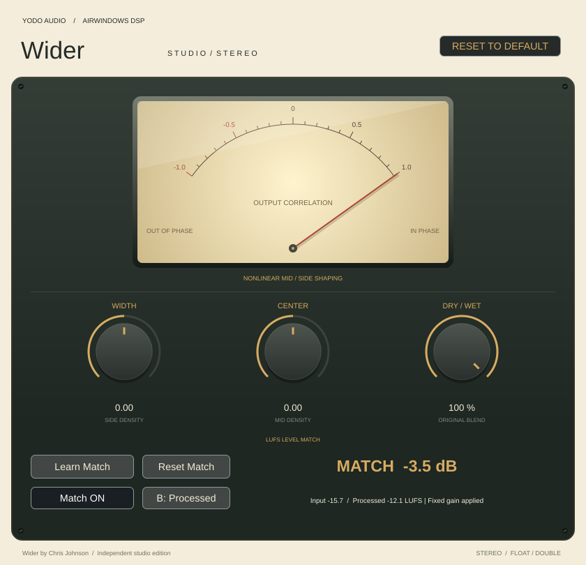

# Wider Studio

A native UI around **Airwindows Wider**, in the cream, charcoal and brass style of
[Yodo Audio ToTape Studio](https://github.com/johandoornenbal/tape) and
[ButterComp Studio](https://github.com/johandoornenbal/codex-tryout).
Independent VST3 edition for stereo tracks; Apple Silicon release target.



| Control | Range | Default |
| --- | --- | --- |
| Width | −1 to +1, original side density | 0 |
| Center | −1 to +1, original mid density | 0 |
| Dry / Wet | 0–100%, original mix law | 100% |

Drag a knob or type its value. Double-click resets that control. Reset to Default
resets the three knobs and the Match/A/B switches with host automation gestures.
Reset Match clears only the learned gain. All controls support host
automation and session recall. Stereo float and double processing are supported.

The illuminated meter measures **output correlation**, from −1 (opposite polarity)
to +1 (correlated). It observes a 300 ms exponential window, with display smoothing;
it returns to zero on silence, bypass or stopped callbacks. Negative correlation
can indicate mono cancellation; the meter is not a width control or a mono guarantee.

Choose **Small (75%)**, **Medium (100%)**, or **Large (125%)** from the size menu
at the top right. The complete interface scales proportionally; Medium retains the
original size. The selection is saved per plugin instance with the session and
survives closing and reopening the editor. Older sessions open at Medium.

## Original DSP

`third_party/airwindows/WiderProc.cpp` is untouched and compiled directly by a thin
host adapter. The optional learned level match and short A/B fades run after this engine;
its DSP is unchanged. Width/Center map from the original normalized parameters to the
original displayed −1…+1 range. Parameters are sampled once per audio block.
Original random startup dither seeding is retained. Tests alone set identical
seeds in both implementations to enable exact comparisons.

Wider's original full-wet neutral output is **1.5× input**, not unity. Its original
mix law, nonlinear mid/side shaping and parameter-dependent side delay are retained.
The delay is part of the stereo effect; no fixed whole-signal latency is added or
reported. Mix at zero retains upstream dither/denormal behavior. This is not a limiter.
This plugin has its own identity and does not replace original Airwindows instances.

## Build, sign, and install on your Mac

Install Xcode Command Line Tools (`xcode-select --install`) and CMake 3.22+
(`brew install cmake`), close your DAW, then run from the repository:

```sh
bash scripts/build-sign-install-mac.sh
```

This one command builds and tests the Apple Silicon VST3, ad-hoc signs a staged
copy, verifies its signature, and installs it to:

`~/Library/Audio/Plug-Ins/VST3/Wider Studio.vst3`

An existing installation is replaced only after the new copy passes signing and
verification. If replacement fails, the script attempts to restore the previous
installation. The source bundle is left unchanged. Restart or rescan plugins in
your VST3 DAW afterwards.

To sign and install an already downloaded/extracted bundle without compiling:

```sh
bash scripts/build-sign-install-mac.sh --install-only "/path/to/Wider Studio.vst3"
```

The script targets arm64 (including M2 and later) and macOS 11+, uses no `sudo`,
and follows the workflow from [GuitarSim](https://github.com/johandoornenbal/guitarsim).
Run it in a native Apple Silicon terminal with Rosetta disabled. The bundle is
ad-hoc signed, not notarized. Logic Pro requires an Audio Unit and cannot load
this VST3 target.

Optional `WIDER_BUILD_DIR` and `WIDER_INSTALL_DIR` environment variables
override the build and installation folders. Extra CMake configure arguments are
passed through, for example:

```sh
bash scripts/build-sign-install-mac.sh -DJUCE_PATH=/absolute/path/to/JUCE
```

The first configure downloads pinned JUCE 8.0.12 unless an existing checkout is
provided. The default build output is:

`build-mac/WiderStudio_artefacts/Release/VST3/Wider Studio.vst3`

For command-line options, run `bash scripts/build-sign-install-mac.sh --help`.
GitHub Actions also builds, tests, ad-hoc signs, and archives the arm64 VST3.
Actual macOS compilation, signing, and DAW playback require verification on a Mac;
Linux script checks do not establish that those steps work.

## Linux cloud development

```sh
bash scripts/setup-cloud.sh
source scripts/cloud-env.sh
```

Setup uses a rootless Debian sysroot with signed APT metadata and pinned JUCE,
then builds the Linux VST3 and runs CTest. It leaves application files and lockfiles
unchanged. The browser and curl integrations are disabled because this UI needs neither.

DSP-only checks without JUCE or GUI dependencies:

```sh
cmake -S . -B build-dsp -DWIDER_DSP_ONLY=ON -DCMAKE_BUILD_TYPE=Release
cmake --build build-dsp --parallel 2
ctest --test-dir build-dsp --output-on-failure
```

The reference suite compares the adapter against the original Wider VST2 class
compiled with a test-only interface: 216 bit-exact float/double cases across
44.1/48/96/192 kHz, parameter extremes, silence and variable block sizes.
Wrapper checks cover automation bindings, defaults/reset, state recall, audio
processing and rendering the actual editor to `build/ui-preview.png`.

## Licenses

Airwindows Wider © Chris Johnson, MIT. Wrapper/UI: MIT, following the two
reference projects. JUCE is separately AGPLv3/commercial licensed. See
[THIRD_PARTY.md](THIRD_PARTY.md). This is not an official Airwindows release.

## Verified in this cloud instance

Linux VST3 compilation and all four CTest suites passed, including 216 bit-exact
upstream comparisons and native editor/state/control checks and independent libebur128 loudness comparisons. The preview above is
rendered from the actual editor. No macOS binary or DAW playback has been tested.

## LUFS level matching

Play a representative section and click **Learn Match**. Learning measures stereo
BS.1770 K-weighted input and processed output before compensation, with absolute
and relative gating. It pauses on silence and finishes after 15 seconds of accepted
audio; **Finish Learning** accepts at least 3 seconds. The resulting gain remains
fixed until you learn again or use **Reset Match**. Changing Width, Center or Mix
may require learning again.

**Match ON/OFF** preserves the learned gain. **A: Original / B: Processed** compares
the untouched input against processed audio with short switching fades. The display
shows signed compensation and measured LUFS. Gain is capped at ±24 dB; this is not
a limiter and does not guarantee peak headroom. Neutral full-wet Wider learns about
−3.5 dB to compensate its original 1.5× gain.

Learned gain and Match/A/B switches are recalled with sessions. Older sessions
load without a learned adjustment. Matching uses bounded storage and does not
allocate during audio processing. The correlation meter observes the final output.
The implementation follows codex-tryout at `c60fa1b798b02b158287f14783efa18aaa85b721`.
